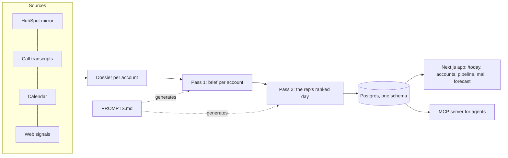

# Revenue OS

### Every morning, each sales rep opens one screen that says what to do today, in order, and why.

**Click the player above (2 min 40 s).** It shows the product in use, the rep's day, the account briefs and the manager view. **This README is the other half:** why it exists, why it's built this way, and where the engineering is deliberate.

> Built at [Fello](https://hifello.com) as lead engineer. The code is private; this is the write-up. By [Aryan Pasreja](https://www.linkedin.com/in/aryan-pasreja/).

---

## For founders and operators

**The problem.** A rep's CRM holds thousands of accounts, call recordings, emails and meetings. Their scarcest resource is the next hour, and they spend the first one deciding what to do with it. Most "AI for sales" ships a chat box. Reps don't want to ask; they want to be told.

**The bet.** One screen, rebuilt every morning, that tells the rep what to do today and shows its evidence. If the list is trustworthy, they stop second-guessing it, and selling time goes up.

**What the rep sees**, in three kinds of work that are deliberately *not* peers:

| | What it is | Ranked? |
|---|---|---|
| **The calendar** | Meetings the rep is actually taking | No, it *is* the day |
| **Obligations** | A promise made on a call, an email awaiting reply, a quote about to expire | By when they came due |
| **Best accounts to work** | What the remaining free time should go to, each with a stated, measured reason | Yes |

The last two are capped by the free time the calendar leaves, so the list is never longer than the day.

**Why it's different from a dashboard or a chatbot**
- It starts from measured behavior in the rep's own pipeline. One finding drives the ordering: stale *meetings* are dead pipeline, stale *quotes* are alive. Old meetings become a sweep list, not work.
- Every recommendation shows its reason. Reps adopt a list they can audit.
- Managers get team views and can "view as" a rep. Agents get the same capabilities through an MCP server.

**How you'd know it works.** The app tracks usage and rep feedback in the product itself. The numbers that matter are whether reps open it daily, act on the top items, and sell more hours per week. Dollar claims need a before/after on real pipeline.

---

## For engineers

### Architecture

A nightly run, plus intraday refreshes, fans out **one run per rep** from a single cron fire, under shared cost bounds. Every read and write is scoped to that rep.

### The app is layered by what code *is*

| Layer | Holds | May import |
|---|---|---|
| Routes | Next.js route files per audience | views, capabilities, platform, agents |
| Views | Screen composition for one audience | capabilities, platform |
| Capabilities | One business concept each: rules, queries, types, standard UI | other capabilities, platform |
| Agents | MCP tool server and any in-app agent | capabilities, platform |
| Platform | Auth, db, flags, design system, analytics, no business rules | platform only |

A boundary checker runs inside the test suite. Its violation count is a **ratchet**: it may go down, never up. Each layer carries its own context file, so a coding agent only reads what the task needs.

### Decisions worth reading

- **Measure, then design.** Every claim in the design doc carries the query and date that produced it. When it couldn't be measured, the doc says so and names the measurement that would settle it.
- **Know where the data lies.** An association column held only the *primary* link, so the biggest umbrella company looked like a 3-contact account while accounting for ~94% of one query's cost. Excluding it took that query from ~30 s to ~130 ms.
- **Match people by email, never domain.** A third of external meetings were on free-mail, because real-estate agents run on it. Domain matching would have lost a third of the day.
- **Prompts are reviewable files.** Ranking rules live in `PROMPTS.md`; the code's prompt text is generated from it. Changing the product's judgment is a diff, not a code change.
- **The rebuild began from a data dictionary, not the old design.** v2 kept only what was *measured* about the data and dropped every old response to it.
- **Source data is read-only.** The pipeline writes only to its own schema.

### Quality gates

TypeScript monorepo (`web`, `pipeline`, `shared`, `db`) with typecheck, lint, unit, DOM, integration and structural tests. Database tiers run against a throwaway local Postgres. ~1,700 commits; plan and decision docs are kept in-repo as history.

### What I'd do next

Close the loop with measured outcomes: link each recommendation to whether the rep acted on it and what happened to the deal, then feed that back into the ranking prompts.

---

**Stack:** TypeScript · Next.js 15 · Postgres/Supabase · OpenRouter models · MCP · HubSpot app · Railway · pnpm · Vitest
